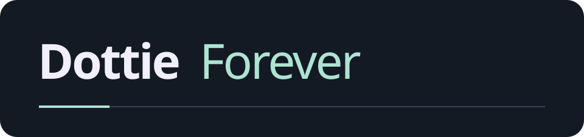

# Dottie Forever

**Ask WoW Forever questions by voice, solo or with your guild in Discord.**



Who starts this quest? Where do we turn it in? Ask your ChatGPT Dot while you play and use Polestar as its WoW Forever reference. Dottie Forever routes the audio on your Mac, so you can keep your game in front of you and hear the answer in your headphones.

A wake phrase opens Dot’s input when you have a question. A standby phrase closes it while you keep talking to your guild. With Discord connected, a guildmate can wake Dot and everyone in voice can hear its reply. In solo play, leave Discord out and ask from your own microphone.

## Demo


<!-- When the video is posted, change the line above to [](FINAL_X_POST_URL). -->

## Set up with your Dot

Use a Dot with command access to the Mac you’ll play on. Read the [requirements](#requirements), then paste this prompt.

> Help me set up Dottie Forever from source on this Mac. Clone https://github.com/teereximus1337/dottie-forever into a new folder and follow the README. Run the preflight and unprivileged build. Stop if a check fails or Dottie is already installed. Walk me through the driver install, reboot and macOS permissions so I can do those myself. Help me test solo and, if I choose, in Discord. Show me how to restore audio and uninstall.

## Set up manually

**Available from source.** The Apple Silicon build has been verified. Use a clean Mac for your first installation. The full setup and uninstall flow and live voice routing still need end-to-end verification.

### Install with one command

Check the [requirements](#requirements), note your current microphone and output, and quit ChatGPT and Discord after ending active calls. Review the [driver script at the pinned revision](https://github.com/teereximus1337/dottie-forever/blob/6d378baf2106db22c06d6c4cb163c3152811775b/macos/setup/driver.sh) before running this in Terminal.

```sh
( test ! -e "$HOME/dottie-forever" && test ! -L "$HOME/dottie-forever" && /usr/bin/git clone --branch main --single-branch https://github.com/teereximus1337/dottie-forever.git "$HOME/dottie-forever" && cd "$HOME/dottie-forever" && /usr/bin/git checkout --detach 6d378baf2106db22c06d6c4cb163c3152811775b && /bin/bash macos/setup/preflight.sh && /bin/bash macos/setup/build.sh --full && /usr/bin/sudo /bin/bash macos/setup/driver.sh install "$PWD/build/Dottie Forever.app" )
```

This uses the reviewed setup at `6d378ba`. It builds `~/dottie-forever/build/Dottie Forever.app` and installs the virtual driver and broker with administrator approval. After it succeeds, restart your Mac and open the app with `open "$HOME/dottie-forever/build/Dottie Forever.app"`. Follow the macOS permission instructions in step 4 below. Keep the checkout for [uninstalling](#uninstall-and-restore-audio).

### Build the app and install its virtual inputs

1. Note the microphone and output you use in macOS, ChatGPT and Discord so you can restore them. Check the [requirements](#requirements) before continuing.
2. Run the following commands in Terminal on the Mac.

   ```sh
   git clone https://github.com/teereximus1337/dottie-forever.git &&
   cd dottie-forever &&
   bash macos/setup/preflight.sh &&
   bash macos/setup/build.sh
   ```

   The build verifies pinned dependencies and assembles `build/Dottie Forever.app` locally. Use `bash macos/setup/build.sh --manual` if you prefer the on-screen gate. [Wake model and notices](macos/keyword/DEPENDENCIES.md)
3. End any active calls and quit ChatGPT and Discord. Inspect `macos/setup/driver.sh` in the checkout, then run the install command yourself as a Mac administrator.

   ```sh
   sudo /bin/bash macos/setup/driver.sh install "$PWD/build/Dottie Forever.app"
   ```

   The driver supplies virtual microphones to ChatGPT and Discord. The local audio broker feeds the mix into those inputs. Restart your Mac after the install succeeds.
4. After the restart, return to the checkout in Terminal and open the app with `open "build/Dottie Forever.app"`. When prompted while starting routing, allow Dottie Forever to use your microphone and capture system audio. If macOS offers a system-audio-only choice, use it. Quit and reopen the app if macOS asks. Review the permissions under **System Settings → Privacy & Security**. [Microphone](https://support.apple.com/en-tj/guide/mac-help/mchla1b1e1fe/mac) · [System audio recording](https://support.apple.com/guide/mac-help/control-access-screen-system-audio-recording-mchld6aa7d23/mac)

### Ask solo

1. Start a Dot voice conversation in the ChatGPT desktop app and let it speak once. In Dottie Forever, select your physical microphone and connect it to **ChatGPT input**.
2. In your Dot voice session, select the virtual microphone named in the Dottie **ChatGPT** node. Its default name is **Router · Assistant**. Keep playback on your usual headphones.
3. In Dottie, select **Refresh sources**, then **Start routing**. The feed should start on standby. A voice-enabled build starts with **Hey Dot** and **Dot standby**. To change them, enter two distinct English phrases in **Settings → Voice phrases** and choose **Save names & phrases**. Use letters, spaces and apostrophes, up to 64 characters per phrase. Enable **Use voice phrases** on the ChatGPT node.
4. Say the wake phrase, pause briefly, then ask your question. Hear the reply in your headphones, then say the standby phrase and check that Dot’s input closes. In a manual build, use **Wake ChatGPT** and **Standby** on the ChatGPT node.

### Ask with your guild

1. Tell your guildmates when their voice may be sent to Dot. Join a voice channel in the Discord desktop app and have a guildmate speak once.
2. In Dottie, select **Add Discord**. Choose the microphone shown on the Discord node in Discord’s **Voice & Video** settings. Its default name is **Router · Apps**. Leave Discord playback on your usual headphones. [Discord audio settings](https://support.discord.com/hc/en-us/articles/214925018-Where-d-my-Audio-Input-go-Various-Voice-Issues)
3. Enable **Let Discord hear my microphone**, **Let Discord hear ChatGPT**, and **Let ChatGPT hear Discord voices**. Apply the changes, then start routing if needed.
4. Have the guildmate say your wake phrase, pause briefly, then ask a question. Confirm everyone in voice hears the reply. Say the standby phrase and check that Dot’s input closes while you and your guildmate can still hear each other.

### Check recovery

With routing stopped, end the Dot call and quit the ChatGPT desktop app completely. Try **Start routing**. The centered **Couldn’t start routing** dialog should explain what’s missing. Reopen the call, let Dot speak, and use **Refresh sources** to try again. Stop routing, quit and reopen Dottie, and check that your saved microphone, routes and phrases are still selected. Start routing again and check that Dot begins on standby, then repeat a real voice exchange. The routing check sees local Core Audio sources. Use that live exchange to confirm the call is accepting your audio.

## Requirements

- An Apple Silicon Mac on macOS 15 or later. Use Dottie from one trusted local account and run setup in a native arm64 Terminal from that desktop administrator account.
- Apple’s Xcode Command Line Tools or Xcode, with a macOS 14.4 or newer SDK and Python 3. Run `xcode-select --install` if the tools are missing. [Apple’s installation guide](https://developer.apple.com/documentation/xcode/installing-the-command-line-tools/)
- An internet connection for dependency downloads and voice, and a microphone and headphones.
- The ChatGPT desktop app signed in to an account with access to a Dot voice session. Add the Discord desktop app for guild voice. [ChatGPT Voice availability](https://help.openai.com/en/articles/20001274-chatgpt-voice)

## Troubleshooting

| If you see | Try this |
| --- | --- |
| An unfinished driver operation | From the checkout, run `sudo /bin/bash macos/setup/driver.sh recover` to roll back the interrupted operation, then restart your Mac. |
| **Couldn’t start routing** in the center of the canvas | Open your Dot voice session and let it speak once. If you connected Discord’s return to Dot, join a Discord voice channel and have someone speak. Use **Refresh sources**, then start routing again. Remove Discord’s return for solo play. |
| The virtual microphone is missing | Reboot after installing the driver. Reopen Dottie, ChatGPT and Discord, then refresh sources. Choose the microphone name shown on the appropriate Dottie node. |
| Dot can’t hear me | Check your physical microphone in Dottie, the virtual microphone in Dot, and whether the gate is open. If the input is open and Dot is still silent, end the call and start a fresh one with the same virtual microphone. |
| The guild can’t hear Dot, or Dot can’t hear the guild | Check the Discord route switches, Discord’s selected input, and whether the voice session is active. Have a guildmate speak once, then refresh sources. |
| A wake phrase doesn’t work | Check **Use voice phrases** and the saved phrase in a voice-enabled build. Confirm that the footer says **Wake listener ready**. Use the on-screen gate if you built in manual mode. |

## Uninstall and restore audio

1. In Dottie, choose **Stop routing** and quit the app. Return ChatGPT and Discord to the input and output you noted earlier, end any calls, and quit both apps. If you changed macOS Sound settings, restore those selections too.
2. Run the driver removal command yourself from the checkout.

   ```sh
   sudo /bin/bash macos/setup/driver.sh uninstall
   ```

3. Restart the Mac. Confirm the virtual inputs are gone and your physical microphone and headphones work in ChatGPT and Discord. Move the built Dottie Forever app to the Trash and turn off its grants in **System Settings → Privacy & Security** if they’re still listed.
4. To remove the settings and diagnostics created by this install, move `~/.audio-router` out of your home folder or to the Trash. If Dottie created a private bridge folder in `/Users/Shared`, you can remove it too. Print its exact path with `printf '/Users/Shared/AudioRouter-%s\n' "$(id -u)"`.

Dottie creates no recordings or transcripts. It uses a private disk-backed buffer to pass up to 0.32 seconds of PCM per virtual input to Core Audio. A normal stop clears the samples. A crash can leave those samples in the bridge file until a clean stop or removal. The virtual inputs are system-wide and other local apps with microphone access can select them. Audio routed to ChatGPT and Discord is subject to those services’ own handling.

## Give Dot a WoW Forever reference

Polestar publishes guides and quest data. Open the conversation you use for voice, share the guide, and ask, “Who starts The Lost Scout, and who do I turn it in to? Cite the guide step.” The Polestar node on the canvas is a reminder to set up the reference in your Dot conversation. [Alliance Riverglades guide](https://polestar.guide/guides/alliance/40-50/01b-riverglades)

To use the pinned quest database, set it up on your Dot’s VM and check the result in the same voice session. Try asking, “Who gives A Threat Within and who takes it? Tell me the Polestar release and record IDs.” [Dot VM setup](docs/POLESTAR.md#set-up-a-testers-dot-vm) · [Voice test and coverage](docs/POLESTAR.md#verify-in-the-same-voice-session)

Thanks to [Samir from Dots](https://x.com/_samirism), [Fitz from Polestar](https://x.com/0xFitz), and the [Polestar contributors](https://github.com/fitzforge/polestar). Dottie Forever is an independent project.

## License

Download, build, fork, and adapt Dottie Forever independently. The [MIT License](LICENSE) covers the project's original source code, tests, build scripts, and written documentation. The [wordmark](docs/dottie-wordmark.svg), [demo placeholder](docs/dottie-demo-placeholder.svg), and [share card](docs/dottie-share-card.png) are project branding outside the MIT grant.

Third-party components and notices retain their own terms. The build downloads the [wake runtime and model](macos/keyword/DEPENDENCIES.md) and preserves notices alongside the app. The [Polestar database](docs/POLESTAR.md#coverage-and-attribution) is downloaded separately under its upstream terms.

<!-- The wordmark and demo placeholder are original Dottie Forever text and geometry. The GitHub social preview at docs/dottie-share-card.png uses the same palette and wordmark treatment with rasterized Avenir Next lettering. It contains no third-party marks or artwork. -->
